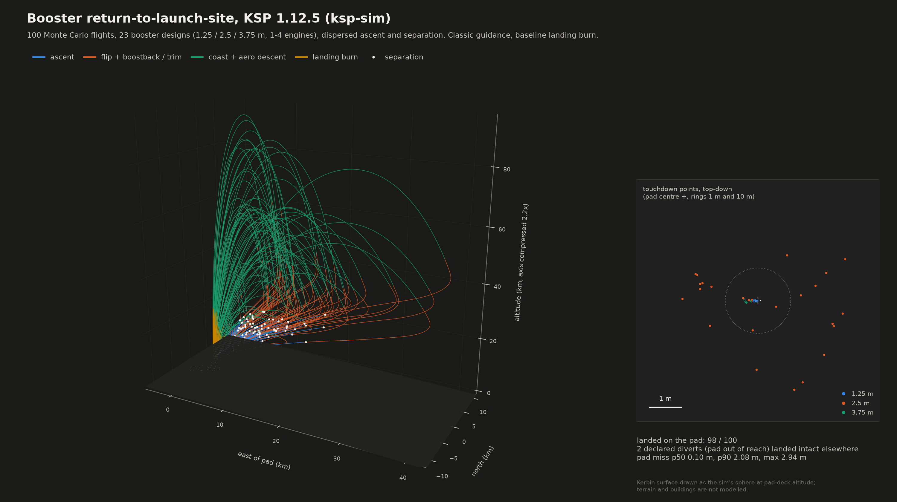

# Monte Carlo results

400 random boosters x 8 dispersed flights = 3,200 full missions per run (pad -> ascent ->
separation -> boostback -> descent -> landing), same seed (2026) in every run, so every version
flies identical boosters and dispersions (paired). "Model err" = the truth spec carries unknown
thrust (sigma 2 %) and drag (sigma 5 %) errors the guidance doesn't know about.

Pad miss = horizontal CoM distance from the pad centre after settling, for flights aimed at the
pad that landed intact. *Declared* = flights the guidance itself took off the pad: abort (return
infeasible: propellant at separation, or attitude authority during boostback) or divert (pad
beyond the landing burn's reach at ignition, landed at the predicted touchdown point). Success =
intact pad landing within 10 m.

Target set by Eric: every intact pad landing within a few metres (p99 < 3 m, max < 5 m), all
classes, including the model-error run.

## Version history

| version | change |
|---|---|
| v1 | first full guidance (energy ignition, swing-unaware predictor, long aim off) |
| v2 | swing model in the predictor (large-angle aero tables + rotation dynamics), 6-DOF swing correction, flip loss in the MECO budget, abort / divert declarations, off-axis boostback trim fixes |
| v3 | abort only on a finite shortfall, coast when flip assist can't win, divert reach 0.1, authority abort |
| v4 | final-segment tilt taper, final-segment time to go bounded by time left, reach back to 0.2 |
| v5 | full-throttle flip assist limited to one flip time (then coast) |
| v6 | attitude rate cap in the final segment (final) |

## Per class, every version

| run | class | success (<=10 m, pad-aimed) | intact | declared | pad miss p50 / p90 / p99 / max (m) | v_down p99 | v_horiz p99 |
|---|---|---|---|---|---|---|---|
| v1 | all | 97.7 % | 98.7 % | 0 | 0.27 / 0.88 / 49.11 / 1885.17 | 1.49 | 0.84 |
| v1 | 1.25 m | 98.8 % | 99.3 % | 0 | 0.08 / 0.49 / 1.28 / 490.95 | 1.53 | 0.34 |
| v1 | 2.5 m | 96.9 % | 98.5 % | 0 | 0.31 / 0.77 / 117.80 / 1885.17 | 1.50 | 1.03 |
| v1 | 3.75 m | 97.8 % | 98.6 % | 0 | 0.34 / 1.06 / 3.17 / 745.79 | 1.44 | 0.77 |
| v2 | all | 98.9 % | 99.8 % | 33 | 0.27 / 0.83 / 1.72 / 4.39 | 1.48 | 0.63 |
| v2 | 1.25 m | 97.9 % | 100.0 % | 14 | 0.13 / 0.66 / 1.60 / 4.39 | 1.33 | 0.08 |
| v2 | 2.5 m | 99.0 % | 99.8 % | 13 | 0.28 / 0.69 / 1.42 / 2.55 | 1.50 | 0.68 |
| v2 | 3.75 m | 99.4 % | 99.8 % | 6 | 0.32 / 1.03 / 2.29 / 3.49 | 1.45 | 0.18 |
| v3 | all | 97.4 % | 99.8 % | 81 | 0.29 / 0.90 / 2.02 / 5.42 | 1.48 | 0.62 |
| v3 | 1.25 m | 92.3 % | 99.9 % | 51 | 0.14 / 0.74 / 1.58 / 2.73 | 1.35 | 0.09 |
| v3 | 2.5 m | 97.9 % | 99.7 % | 25 | 0.32 / 0.80 / 1.96 / 5.42 | 1.50 | 0.68 |
| v3 | 3.75 m | 99.6 % | 100.0 % | 5 | 0.33 / 1.04 / 2.29 / 3.49 | 1.45 | 0.18 |
| v4 | all | 98.2 % | 99.8 % | 55 | 0.10 / 0.92 / 2.65 / 3.21 | 1.45 | 0.78 |
| v4 | 1.25 m | 93.9 % | 99.9 % | 40 | 0.01 / 0.13 / 0.23 / 0.31 | 1.34 | 0.12 |
| v4 | 2.5 m | 99.0 % | 99.7 % | 11 | 0.14 / 2.09 / 2.82 / 3.21 | 1.43 | 0.85 |
| v4 | 3.75 m | 99.7 % | 100.0 % | 4 | 0.12 / 0.28 / 0.48 / 0.59 | 1.45 | 0.22 |
| v5 | all | 99.0 % | 99.9 % | 29 | 0.09 / 0.91 / 2.65 / 19.36 | 1.45 | 0.78 |
| v5 | 1.25 m | 97.6 % | 100.0 % | 16 | 0.01 / 0.12 / 0.23 / 0.28 | 1.34 | 0.11 |
| v5 | 2.5 m | 99.1 % | 99.8 % | 9 | 0.11 / 2.09 / 2.83 / 19.36 | 1.43 | 0.85 |
| v5 | 3.75 m | 99.7 % | 100.0 % | 4 | 0.12 / 0.28 / 0.48 / 0.59 | 1.45 | 0.22 |
| v6 (final) | all | 99.0 % | 99.9 % | 29 | 0.09 / 0.90 / 2.64 / 19.36 | 1.45 | 0.78 |
| v6 (final) | 1.25 m | 97.6 % | 100.0 % | 16 | 0.01 / 0.12 / 0.23 / 0.28 | 1.34 | 0.11 |
| v6 (final) | 2.5 m | 99.1 % | 99.8 % | 9 | 0.11 / 2.08 / 2.94 / 19.36 | 1.44 | 0.86 |
| v6 (final) | 3.75 m | 99.7 % | 100.0 % | 4 | 0.12 / 0.28 / 0.48 / 0.59 | 1.45 | 0.22 |
| v1 + model err | all | 97.7 % | 98.7 % | 0 | 0.28 / 0.86 / 9.01 / 942.82 | 1.54 | 0.76 |
| v1 + model err | 1.25 m | 98.4 % | 98.7 % | 0 | 0.08 / 0.55 / 2.21 / 685.94 | 1.43 | 0.64 |
| v1 + model err | 2.5 m | 96.5 % | 98.3 % | 0 | 0.33 / 0.74 / 49.23 / 942.82 | 1.55 | 1.15 |
| v1 + model err | 3.75 m | 98.6 % | 99.2 % | 0 | 0.34 / 1.06 / 2.81 / 495.68 | 1.51 | 0.49 |
| v6 + model err | all | 98.8 % | 99.9 % | 36 | 0.09 / 0.77 / 2.94 / 8.58 | 1.52 | 0.84 |
| v6 + model err | 1.25 m | 96.1 % | 100.0 % | 26 | 0.01 / 0.11 / 0.23 / 0.32 | 1.39 | 0.13 |
| v6 + model err | 2.5 m | 99.0 % | 99.7 % | 9 | 0.12 / 2.18 / 3.38 / 8.58 | 1.51 | 0.92 |
| v6 + model err | 3.75 m | 99.9 % | 100.0 % | 1 | 0.12 / 0.30 / 0.54 / 0.69 | 1.55 | 0.27 |
| G-FOLD v1 | all | 95.9 % | 97.9 % | 0 | 0.75 / 3.79 / 63.75 / 1188.51 | 1.48 | 1.40 |
| G-FOLD v1 | 1.25 m | 98.8 % | 99.1 % | 0 | 0.16 / 0.71 / 2.21 / 310.27 | 1.35 | 0.57 |
| G-FOLD v1 | 2.5 m | 94.6 % | 96.9 % | 0 | 1.05 / 5.04 / 59.22 / 1188.51 | 1.49 | 1.42 |
| G-FOLD v1 | 3.75 m | 95.7 % | 98.2 % | 0 | 1.23 / 4.22 / 86.32 / 782.40 | 1.45 | 1.42 |
| G-FOLD v5 | all | 97.9 % | 99.8 % | 29 | 0.10 / 2.28 / 10.31 / 168.14 | 1.45 | 1.27 |
| G-FOLD v5 | 1.25 m | 97.6 % | 100.0 % | 16 | 0.01 / 0.12 / 0.23 / 0.28 | 1.34 | 0.11 |
| G-FOLD v5 | 2.5 m | 98.0 % | 99.6 % | 9 | 0.15 / 2.59 / 10.27 / 28.38 | 1.44 | 1.06 |
| G-FOLD v5 | 3.75 m | 97.9 % | 99.9 % | 4 | 0.12 / 2.41 / 15.92 / 168.14 | 1.45 | 1.49 |

Full per-class tables (TWR bands, engine counts, engine types, touchdown speeds, fuel margins)
for each run: `python -m ksp_guidance.report runs/<run>.npz` (v6 tables in `docs/v6_*.md`).

## Verdict against the bar (v6)

* **1.25 m and 3.75 m classes: met** in both runs (p99 0.23 / 0.48 m nominal, 0.23 / 0.54 m
  with model errors; max <= 0.69 m).
* **All classes, nominal: p99 2.64 m — met; max 19.4 m — not met** (one flight, #105: a
  1xMainsail booster that reached ignition 147 m off the pad, just inside the divert threshold
  (reach x 0.2 = 160 m), and landed 19.4 m off).
* **2.5 m class with model errors: p99 3.38 m, max 8.6 m — not met.** 27 of the 29 landings
  above 3 m are 3xVector clusters (and one 2xVector) landing 3.0-3.7 m off with ~0.9 m/s of
  residual drift at contact; one 4xSkipper lands 8.6 m off. Vector engines gimbal 10.5 deg: the
  nozzle deflection used to rotate the booster pushes it sideways (a non-minimum-phase side
  force). KSP's pitch/yaw input drives wheels and gimbal together, so the allocator can't route
  rotation through the wheels alone; cancelling the measured side force destabilised the loop
  (tried, off) and a final-segment rate cap only shaved the tail.
* **G-FOLD** (v5): small boosters identical to the baseline (it hands over before planning);
  2.5 / 3.75 m p99 10.3 / 15.9 m. Not at the bar; the baseline is the default law.

## Failures and declared outcomes (v6 nominal)

* 4 flights not intact of 3,200; 3 separated below 13 km. 26 diverts (25 landed intact) and 3
  aborts (2 landed intact) were declared by the guidance and are excluded from the pad statistics.
* Physically infeasible case shown in detail: flight #704 (1xSkipper, one tank) separates at
  7.1 km, 10 km downrange. At q ~ 22 kPa the booster sits at 165 deg angle of attack for 100 s:
  its 30 kN m wheel and 2 deg gimbal can't overcome the aero moment (body rate 0.027 rad/s), so it
  can neither hold the boostback attitude nor get engine-first before the ground; the guidance
  declares an authority abort, but with the thrust axis along the velocity no landing burn can
  stop it. Fix belongs to the vehicle / ascent (MECO higher, more control authority), not the
  landing law.
